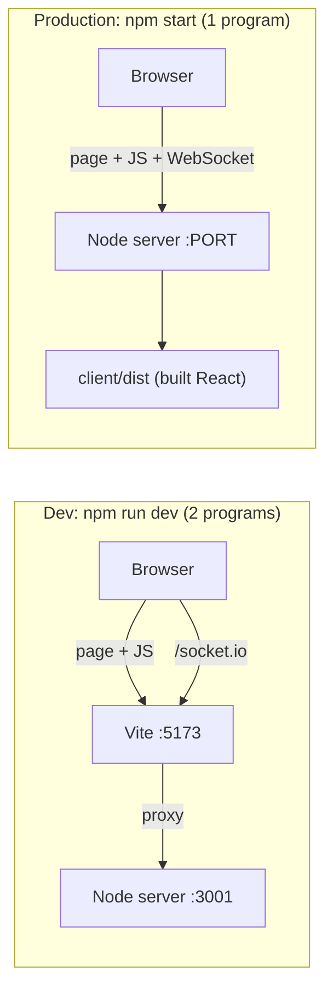
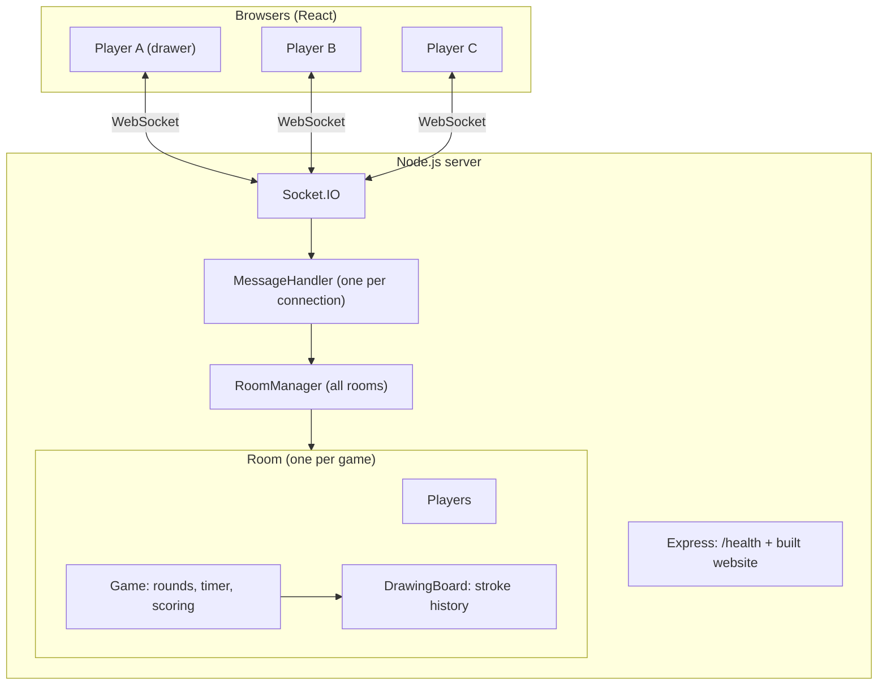
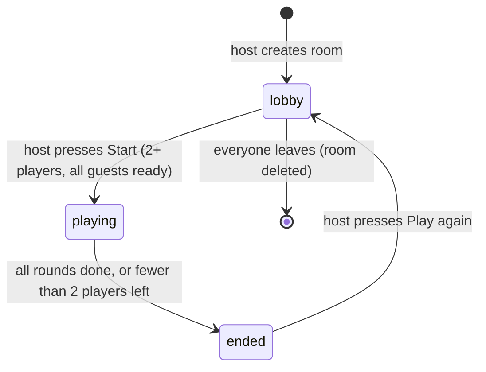
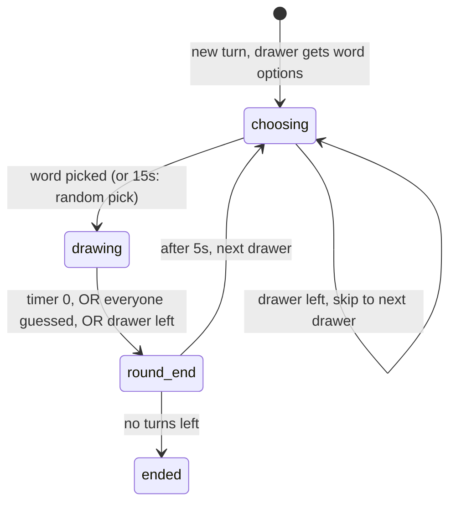
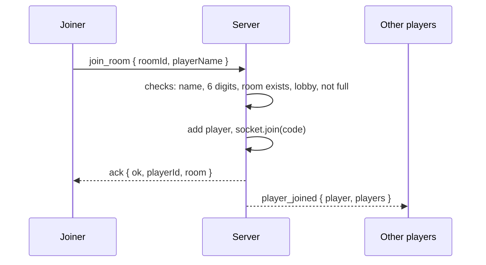
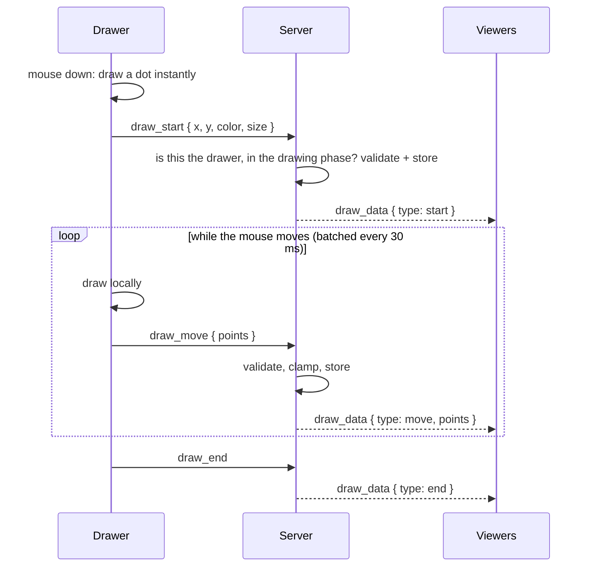
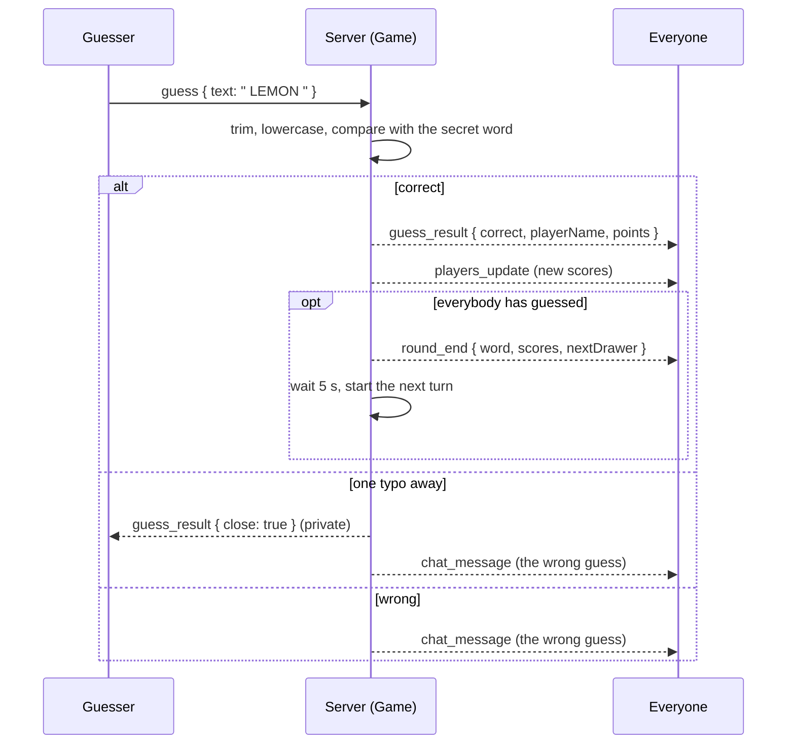
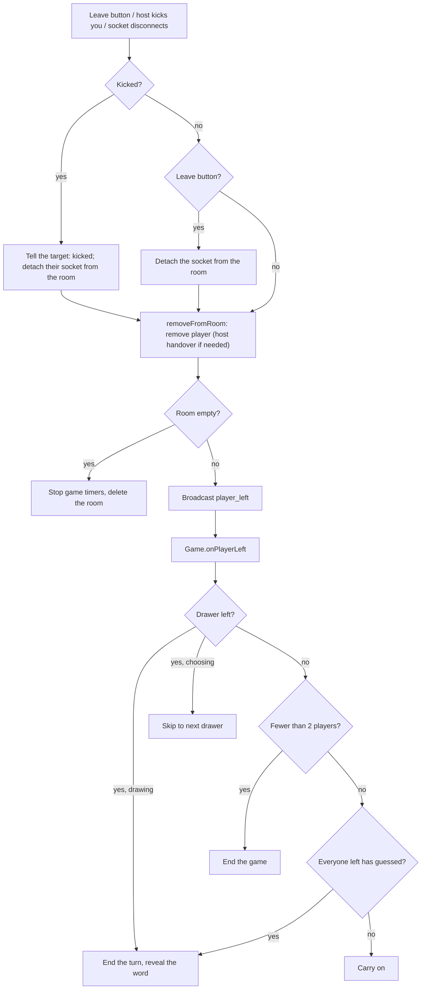

# Skribbl

A real-time multiplayer **drawing and guessing game** (like [skribbl.io](https://skribbl.io)) built with React, Node.js, Express and Socket.IO.

## Live demo

**Play: https://skribbl-clone-col1.onrender.com/**

> [!IMPORTANT]
> **The first load can take up to a minute.** The game runs on Render's free tier, which sleeps after ~15 minutes without visitors; the first visitor wakes it up while Render shows its own "starting" page. After that it is fast. Also: a restart or redeploy ends games in progress (state is in memory), and there is a single server instance. See [Limitations](#11-limitations).

## Contents

1. [What it is](#1-what-it-is) · 2. [Features](#2-features) · 3. [Tech stack](#3-tech-stack) · 4. [Run locally](#4-run-locally)
5. [Architecture](#5-architecture) · 6. [Game flow](#6-game-flow) · 7. [How the features work](#7-how-the-features-work)
8. [API: routes and events](#8-api-routes-and-events) · 9. [Request flows](#9-request-flows) · 10. [Security](#10-security-and-fairness)
11. [Limitations](#11-limitations) · 12. [Folder structure](#12-folder-structure) · 13. [Deployment](#13-deployment) · 14. [Glossary](#14-glossary)

---

## 1. What it is

Pictionary with friends, each on their own device:

1. One person **creates a room** and gets a **6-digit code** (e.g. `482913`). Others **join** by code, invite link, or the public room list.
2. The host presses **Start**. Each turn one player is the **drawer**: they pick a word and draw it, and everyone else sees the drawing appear **live**.
3. Everyone else types **guesses**. Faster correct guesses earn more points.
4. Turns rotate until everyone has drawn; the highest score wins.

The drawing reaches everyone instantly thanks to **WebSockets**: a connection that stays open between browser and server, instead of the browser repeatedly asking "anything new?".

---

## 2. Features

| Area | What works |
|---|---|
| **Rooms** | Create with settings; join by code, invite link (`/?room=CODE`) or **Browse public** (max 10 listed); lobby with ready-up; host starts; **Leave** and host **Kick** |
| **Drawing** | Live sync; brush, 10 colors, 3 sizes, eraser, undo, clear (drawer only) |
| **Game** | Rotating drawer, word choice (1-5, 15s auto-pick), countdown, hints, 3 word modes, scoring, scoreboard, winner and leaderboard, play again |
| **Chat** | Wrong guesses show as chat; drawer and correct guessers chat privately; "X guessed the word!" |
| **Hosting** | Deployed on Render |
| **Not built** | Ban, reconnect after refresh, spectators, custom word lists (see [Limitations](#11-limitations)) |

---

## 3. Tech stack

| Part | Technology | Why |
|---|---|---|
| Frontend | React 18 + Vite | React keeps the screen in sync with data; Vite is a fast dev tool |
| Drawing | HTML5 Canvas, custom code | Full control over how strokes are stored and sent |
| Backend | Node.js + Express | Same language as the client; serves the site and `/health` |
| Real-time | Socket.IO | WebSockets plus rooms, named events, acknowledgements, auto-reconnect |
| Storage | Server memory | Games are short-lived. Trade-off in [Limitations](#11-limitations) |

---

## 4. Run locally

Needs [Node.js](https://nodejs.org) 18+.

```bash
npm run install:all   # installs root + server + client
npm run dev           # server on :3001 and Vite on :5173
```

Open **http://localhost:5173**. To test multiplayer alone, open two or three tabs (or a normal and an incognito window).

| Command | What it does |
|---|---|
| `npm run install:all` | Installs packages for root, `server/` and `client/` |
| `npm run dev` | Runs the game server and Vite together |
| `npm run build` | Installs server and client deps (including dev tools like Vite) and builds React into `client/dist` |
| `npm start` | Production server: serves the built app and the sockets |

Env vars: `PORT` (default `3001`; hosts set it for you) and `ROUND_END_SECONDS` (default `5`; only change for tests).

**Dev vs production**



The client calls `io()` with no address, meaning "connect to whoever served this page". So dev and production use identical code, with no CORS setup and no URL to change.

---

## 5. Architecture

> **The server is the boss. Browsers only ask, and show what the server says.**

A browser never decides "I guessed right" or "I get 500 points". It sends the guess, and the server decides. The secret word is only ever sent to the drawer.



| Class | Job |
|---|---|
| `RoomManager` | All rooms by code; makes unique codes; lists public rooms |
| `Room` | Players, settings, host, phase; broadcast helpers |
| `Player` | One person: name, score, ready flag; safe public view |
| `Game` | Turns, timer, word, hints, scoring, chat routing |
| `DrawingBoard` | Validates and stores strokes (undo, clear) |
| `MessageHandler` | One per connection: receives events, checks rules, replies |

**Three kinds of state:** *connection* (`socket.id`, lives in Socket.IO), *game state* (server memory), *screen state* (React, a **copy** of server state; if they disagree, the server wins).

**Two meanings of "room":** our `Room` class holds game data and rules; a *Socket.IO room* is just a mailing list of sockets. Both use the same 6-digit code, so `io.to(code).emit(...)` means "everyone in this game".

**Three ways browser and server talk**

| Pattern | Used for | Why |
|---|---|---|
| **Acknowledgement** (`emit(event, data, callback)`) | create/join, list rooms, ready, start, leave, kick, play again | Caller needs to know if it worked, to show an error |
| **Broadcast** (server to many) | player list, game state, timer, results | Everyone must hear about changes |
| **Fire and forget** | drawing, guessing, chatting, word choice | Very frequent; the outcome comes back as a broadcast |

---

## 6. Game flow



Inside `playing`, every turn runs through this cycle:



A **turn** is one player drawing; a **round** is everyone drawing once. Total turns = rounds x players.

---

## 7. How the features work

### Room settings (validated and clamped by the server)

| Setting | Allowed | Default |
|---|---|---|
| Max players | 2-20 | 8 |
| Rounds | 2-10 | 3 |
| Draw time | 15-240 s | 80 |
| Word choices | 1-5 | 3 |
| Hints | 0-5 | 2 |
| Word mode | normal / hidden / combination | normal |
| Private | true / false | true |

Out-of-range values (e.g. edited in DevTools) are clamped: `rounds: 99` becomes `10`.

**Word modes:** *Normal* shows blanks with the word length; *Hidden* shows nothing; *Combination* glues two words together ("cat umbrella"). The word list has 5 categories (animals, objects, food, actions, places) and avoids repeats within a game.

### Joining: code, invite link, public list
- **Code:** type the 6 digits. **Invite link:** `/?room=CODE` opens the Join tab with the code filled in (the code is validated as 6 digits, as URLs are user input).
- **Browse public:** lists rooms that are **public, in the lobby, and not full**: host name, `players/max`, rounds, draw time, and nothing else. Max **10**, fullest first, refreshed every 5 s.
- The list is only for *finding* rooms. Joining uses the same `join_room`, re-validated by the server, so a stale list just gives "Room is full".
- Lobby: 👑 host, ⏳ not ready, ✅ ready. Start needs 2+ players with all guests ready.

### Leaving and kicking
- **Leave** (Lobby, Game, Game-over screens; confirms mid-game) removes you immediately and returns you to Home.
- **Kick** (host only, Lobby and Scoreboard): the target gets a "removed by the host" message on Home; everyone else sees "X was removed by the host". A kicked player *can* rejoin with the code (no ban).
- Leave, kick and a closed tab all share **one cleanup path** on the server (`removeFromRoom`):
  - the host role passes to the longest-present player;
  - an empty room is deleted and its timers stopped;
  - the drawer leaving mid-turn ends that turn, a guesser leaving may end it (if everyone left has guessed);
  - fewer than 2 players left ends the game.

### Drawing: how a stroke travels
1. Mouse down: the browser records the position as **x, y between 0 and 1** (a fraction of the canvas, not pixels), so phones and big screens agree.
2. The drawer's own screen draws **immediately** (no network wait).
3. Points are **batched** for 30 ms and sent as one `draw_move`, instead of hundreds of tiny messages.
4. The server checks the sender is the drawer in the drawing phase, validates and stores the stroke, and relays it to everyone **except** the drawer (who already drew it).
5. Other browsers draw the segment with the same code the drawer used.

**Undo** replays: pixels can't be un-drawn, so the canvas is wiped and every remaining stroke is redrawn (server and every browser). The **eraser** is a stroke in the background color, so undo works on it too.

### Guessing and chat
One text box. What it does depends on who you are (the **server** decides, not the client):

| You are | Message is | Seen by |
|---|---|---|
| Guesser who hasn't guessed yet, during drawing | A guess | Wrong guesses: everyone, as chat |
| Drawer, or already guessed | Private chat | Only the drawer and correct guessers (so nobody leaks the word) |
| Anyone, in lobby or between turns | Chat | Everyone |

### Word matching

| Rule | Example |
|---|---|
| Ignores case, extra spaces, accents, hyphens/punctuation | `  ICE-cream ` matches `ice cream` |
| Ignores spaces when comparing | `icecream` matches `ice cream` |
| **Partial guesses do not count** | `do` or `its a dog` does not match `dog` |
| **"Close" = one typo** (words of 4+ letters) | `lemoq` for `lemon`: the guesser privately sees "So close!", no points |

Partial matches are rejected on purpose, otherwise spamming letters or "the word is dog" would win games.

### Hints
With N hints, a random hidden letter is revealed at `drawTime x i/(N+1)` for i = 1..N (80 s and 2 hints: at 26 s and 53 s). At most **half** the letters are revealed. Hidden mode has none.

### Scoring

| Who | Points |
|---|---|
| **Guesser** | `50 + 300 x (time left / draw time) + order bonus` (1st +150, 2nd +100, 3rd +50): between 50 and 500 |
| **Drawer** | **Half** the average guesser score (failed guessers count as 0); 0 if nobody guesses |

Speed wins. The drawer gets only *half* the average on purpose: with the full average, everyone's total ends up nearly equal over a game (with 2 players it is mathematically always a tie).

A turn ends when the timer hits 0, everyone has guessed, or the drawer leaves. After the last turn the leaderboard appears and the host can **Play again** (same players, scores reset).

---

## 8. API: routes and events

### HTTP

| Method | Path | Returns |
|---|---|---|
| `GET` | `/health` | `{ "status": "ok", "uptime": ... }` (used by the host to check the app is alive) |
| `GET` | `/assets/*`, `index.html` | The built React app from `client/dist` |
| `GET` | anything else | `index.html` (so deep links still load the app) |

### Socket events: client sends

| Event | Payload | Reply (ack) | Who | Checks |
|---|---|---|---|---|
| `create_room` | `{ hostName, settings }` | `{ ok, playerId, room }` | Anyone not in a room | Name (max 20); settings clamped |
| `join_room` | `{ roomId, playerName }` | `{ ok, playerId, room }` | Anyone not in a room | Name; 6 digits; room exists; lobby; not full |
| `list_public_rooms` | none | `{ ok, rooms[] }` | Anyone | Public + lobby + not full; max 10 |
| `toggle_ready` | none | `{ ok }` | Player in a lobby | Room in lobby phase |
| `start_game` | none | `{ ok }` | **Host** | Lobby; 2+ players; guests ready |
| `play_again` | none | `{ ok }` | **Host** | Game over |
| `leave_room` | none | `{ ok }` | Player in a room | In a room |
| `kick_player` | `{ playerId }` | `{ ok }` | **Host** | Not yourself; target in your room |
| `word_chosen` | `{ word }` | none | **Current drawer** | Choosing phase; word is one of the options |
| `guess` / `chat` | `{ text }` | none | Anyone in a room | Trimmed, max 100 chars; both go through one server router |
| `draw_start` | `{ x, y, color, size }` | none | **Drawer, drawing phase** | x,y clamped to 0-1; `#rrggbb`; size 1-50 |
| `draw_move` | `{ points: [{x,y}] }` | none | same | Max 100 points per message |
| `draw_end`, `canvas_clear`, `draw_undo` | none | none | same | Drawer check |

Invalid or unauthorized fire-and-forget events are silently ignored; ack events reply `{ ok: false, error }`.

### Socket events: server sends

| Event | Payload | Sent to |
|---|---|---|
| `player_joined` | `{ player, players }` | Everyone except the joiner |
| `player_left` | `{ playerId, players, hostId, reason }` (`left` / `kicked` / `disconnected`) | Everyone remaining |
| `kicked` | `{ reason }` | **Only the kicked player** |
| `players_update` | `{ players, hostId }` | Everyone (ready flags, scores) |
| `room_reset` | `{ room }` | Everyone (Play again) |
| `round_start` | `{ drawerId, round, totalRounds, drawTime, wordOptions }` | Everyone; `wordOptions` is `null` except for the drawer |
| `game_state` | `{ phase, round, totalRounds, drawerId, timeLeft, word, hint, guessed }` | **Each player separately**; `word` only for the drawer, or everyone after the turn |
| `timer` | `{ timeLeft }` | Everyone, every second |
| `guess_result` | `{ correct, playerId, playerName, points }` / `{ correct: false, close: true }` | Everyone (correct) / only the guesser (close) |
| `chat_message` | `{ playerId, playerName, text, private? }` | Everyone, or only drawer + correct guessers if `private` |
| `round_end` | `{ word, scores, nextDrawer }` | Everyone |
| `game_over` | `{ winner, isTie, leaderboard }` | Everyone |
| `draw_data` | `{ type: 'start' \| 'move' \| 'end', ... }` | Everyone except the drawer |
| `canvas_clear`, `draw_undo` | none | Everyone (except the drawer when they triggered it); `canvas_clear` is also sent to all at the start of every turn |

### Data shapes

```js
player: { id, name, score, isReady, isHost }
room:   { code, phase, hostId, drawerId, settings, players: [player, ...] }
stroke: { color: '#rrggbb', size: 10, points: [{ x: 0.12, y: 0.4 }, ...] }   // x, y in 0..1
```

---

## 9. Request flows

**Join a room** (the same flow runs after a click on a public-list row)



**Drawing**



**A correct guess that ends the turn**



**Someone leaves, is kicked, or disconnects**



---

## 10. Security and fairness

| Concern | How it is handled |
|---|---|
| **Reading the secret word** | `game_state` is built **per player**; only the drawer gets the word, everyone else gets blanks |
| **Fake identity** | The server uses its own `socket.id`; clients never send a `playerId` to say who they are |
| **Fake buttons** | Hiding Start or Kick is cosmetic; the server re-checks "are you the host?" on every request |
| **Drawing out of turn / picking a made-up word** | Every drawing event is checked (room, phase, drawer); the word must be one of the options |
| **Kicking abuse** | Host only, never yourself, target must be in the host's own room (room taken from the socket, not the payload) |
| **Bad or huge input** | Names max 20 chars, messages 100; coordinates clamped to 0-1; colors `#rrggbb`; brush size 1-50 |
| **Memory abuse** | Max 500 strokes, 5000 points per stroke, 100 points per message |
| **Crashing the server** | Every handler is wrapped in `try/catch` |
| **Memory leaks** | Empty rooms are deleted and their timers stopped |
| **Guessable room codes** | Generated with `crypto.randomInt` (not `Math.random`) |

Every request is checked in this order: **valid data, in a room, right phase, right role.**

---

## 11. Limitations

| Limitation | Why | Possible fix |
|---|---|---|
| Refreshing the page drops you from the room | Identity is the socket, which changes on reconnect | Session token + grace period |
| Kick is not a ban | No stable player identity to ban | Needs a token or IP-based ban |
| 6-digit codes can be brute-forced | Only 1,000,000 possibilities | Rate-limit join attempts |
| No chat/draw rate limit | Not built | Limit messages per second |
| Public list refreshes by polling (5 s) | Simpler than live push | Socket.IO "browser" room with broadcasts |
| Late joiners can't join a running game | Joining is lobby-only | Spectator mode |
| Free hosting sleeps when idle (first load up to ~1 min) | Render free tier | Uptime monitor on `/health` (planned), or a paid plan |
| Restart or redeploy ends all games; one instance only | State is in memory | Redis or a database |

---

## 12. Folder structure

```
skribbl_clone/
├── package.json        Root scripts: dev, build, start, install:all
├── render.yaml         Render settings (build/start/health check/Node version)
├── server/src/
│   ├── index.js            Express + Socket.IO; serves client/dist; /health
│   ├── MessageHandler.js   Per-connection events: checks rules, replies
│   ├── RoomManager.js      All rooms; unique codes; public listing
│   ├── Room.js             Players, settings, host, phase, broadcast helpers
│   ├── Player.js           One player; safe public view
│   ├── Game.js             Turns, timer, word, hints, scoring, chat routing
│   ├── DrawingBoard.js     Stroke storage and validation
│   ├── settings.js         Limits, defaults, clamping, name cleaning
│   ├── words.js            Categorized word list
│   └── wordMatch.js        Guess checking (case, trim, accents, "close")
└── client/
    ├── vite.config.js      Dev proxy: forwards /socket.io to the server
    └── src/
        ├── main.jsx, App.jsx   Start React; App picks the screen (Home / Lobby / Game)
        ├── socket.js           The one shared socket
        ├── useGameSocket.js    ALL socket listeners and the state they produce
        ├── drawing.js          CanvasBoard: draw strokes, undo, redraw
        ├── index.css, clay.css Two interchangeable themes (pick one in main.jsx)
        ├── moderation.css      Layout for Leave/Kick buttons
        └── components/
            Home, SettingsForm, BrowseRooms, Lobby, Game, Canvas, Chat, Scoreboard, GameOver
```

`App.jsx` only decides *which screen* to show. `useGameSocket.js` is the only place that listens to socket events, and the client never edits the player list itself: it **replaces** it with what the server sends.

---

## 13. Deployment

One **Web Service on Render**: Express serves the built React app *and* Socket.IO from the same port, so there is a single deployment and no CORS.

| Setting | Value |
|---|---|
| Build / start command | `npm run build` / `npm start` |
| Port | `PORT` (provided by the host) |
| Health check | `/health` |
| Node version | 20 (`NODE_VERSION`) |
| Instances | **1** (state is in memory) |

All of this is in `render.yaml`. Railway works the same way (same scripts; click *Generate Domain*).

**Why not Vercel or Netlify alone?** Their backends are serverless functions that start per request and stop, so they can't hold a WebSocket open. The game needs an always-on server. They could host only the frontend, but that adds a second deployment, CORS rules and a server-URL setting for no benefit.

**Platform notes**
- `client/dist` is not committed; it is built during deploy.
- **The build installs dev dependencies on purpose.** Hosts set `NODE_ENV=production`, which skips dev dependencies, and Vite is one. The root `build` script runs `npm --prefix client install --include=dev`; without it the deploy fails with "vite: not found".
- The free tier sleeps after ~15 minutes idle (first visit up to a minute). A free uptime monitor hitting `/health` every ~5 minutes avoids it.
- The browser connects with `io()` and no address, so on the https site it automatically uses `wss://`.

---

## 14. Glossary

| Word | Meaning |
|---|---|
| **WebSocket** | A connection that stays open so server and browser can message each other any time |
| **Socket.IO** | A library on top of WebSockets: named events, rooms, replies, auto-reconnect |
| **Acknowledgement (ack)** | A reply callback: "did it work?" |
| **Broadcast** | One message to many clients |
| **`socket.id`** | The server-assigned ID of one connection; used as the player's ID |
| **Server-authoritative** | The server makes every decision; clients only display |
| **Normalized coordinates** | Positions as fractions (0-1) of the canvas, not pixels |
| **Batching** | Grouping many small updates into one message |
| **Proxy** | A middleman forwarding requests (Vite uses one in dev) |
| **Clamp** | Forcing a number into an allowed range |
| **Levenshtein distance** | Number of single-letter edits between two words; used for "close" guesses |
