# Skribbl Clone

A real-time multiplayer **drawing and guessing game** (like [skribbl.io](https://skribbl.io)) built with React, Node.js, Express and Socket.IO.

## Live demo

| | Link |
|---|---|
| **Play the game (live URL)** | https://skribbl-clone-col1.onrender.com/ |

> [!IMPORTANT]
> **Free hosting notice: the first load can take up to a minute.**
> The game runs on Render's free tier, which **puts the server to sleep after ~15 minutes without visitors**. The first person to arrive wakes it up, and Render shows its own generic "starting" page while that happens. Afterwards the game is fast for everyone.
>
> If the game doesn't load straight away, give it up to a minute (refresh once if Render's waiting page is still showing after that).
>
> Other limits of this hosting: a restart or redeploy ends games in progress (state lives in memory), and it runs as a single server instance. See [Known limitations](#13-known-limitations).

One player draws a secret word, everyone else races to guess it. Faster guesses earn more points. After everyone has had a turn to draw, the player with the most points wins.

---

## Table of contents

1. [What is this, in plain English?](#1-what-is-this-in-plain-english)
2. [Status: what works today](#2-status-what-works-today)
3. [Tech stack and why](#3-tech-stack-and-why)
4. [Run it on your computer](#4-run-it-on-your-computer)
5. [The big picture (architecture)](#5-the-big-picture-architecture)
6. [How a game plays out (game flow)](#6-how-a-game-plays-out-game-flow)
7. [Every feature, explained](#7-every-feature-explained)
8. [Every route and event (the full API)](#8-every-route-and-event-the-full-api)
9. [Request flow diagrams](#9-request-flow-diagrams)
10. [Security and fairness](#10-security-and-fairness)
11. [Folder structure: what each file does](#11-folder-structure-what-each-file-does)
12. [Deployment](#12-deployment)
13. [Known limitations](#13-known-limitations)
14. [Glossary](#14-glossary)

---

## 1. What is this, in plain English?

Imagine playing Pictionary with friends, but everyone is on their own phone or laptop.

1. One person **creates a room** and gets a **6-digit code** (like `482913`).
2. Friends **join** by typing that code.
3. The host presses **Start**.
4. Each turn, one player is the **drawer**. They pick a word (like "elephant") and draw it. Everyone else sees the drawing appear **live** on their screen.
5. The others **type guesses** in a chat box. The first to type the right word scores points.
6. Turns rotate until everyone has drawn. The highest score wins.

The hard part is making the drawing show up on everybody's screen instantly. For that we use **WebSockets**, which is like a phone call that stays open between your browser and the server, instead of having to "knock on the door" every time you want something.

---

## 2. Status: what works today

| Feature | Status |
|---|---|
| Create room with settings (players, rounds, draw time, words, hints, word mode) | Done |
| Join by 6-digit room code | Done |
| Lobby with player list, ready-up, host starts the game | Done |
| Public rooms: browse and join open rooms (list capped at 10) | Done |
| Private rooms and invite links (`/?room=CODE`) | Done |
| Real-time drawing synced over WebSockets | Done |
| Drawing tools: brush, 10 colors, 3 sizes, eraser, undo, clear | Done |
| Turn-based rounds, rotating drawer | Done |
| Word choice (1-5 words), 15-second auto-pick | Done |
| Guessing, chat, "X guessed the word!" notice | Done |
| Hints (letters revealed over time) | Done |
| Word modes: Normal, Hidden, Combination | Done |
| Scoring, live scoreboard, round-end results | Done |
| Game over screen, winner and leaderboard, play again | Done |
| Countdown timer | Done |
| Host moderation (kick/ban), reconnect after refresh | **Not built yet** |
| Deployed to the internet (Render, free tier) | Done |

---

## 3. Tech stack and why

| Part | Technology | Why this one |
|---|---|---|
| Frontend | **React 18 + Vite** | React keeps the screen in sync with data; Vite is a very fast dev tool |
| Drawing | **HTML5 Canvas** (custom code) | No library needed, and we control exactly how strokes are stored and sent |
| Backend | **Node.js + Express** | Runs JavaScript on the server; serves the website and a health check |
| Real-time | **Socket.IO** | WebSockets plus rooms, named events, auto-reconnect, and acknowledgements |
| Language | **JavaScript (ES modules)** | One language everywhere |
| Storage | **Server memory** (no database) | Games are short-lived; the trade-off is explained in [Known limitations](#13-known-limitations) |

---

## 4. Run it on your computer

**You need:** [Node.js](https://nodejs.org) version 18 or newer.

```bash
# 1. Install everything (root + server + client)
npm run install:all

# 2. Start both servers at once
npm run dev
```

Then open **http://localhost:5173**.

To test multiplayer alone, open **two or three browser tabs** (or one normal and one incognito window) and join the same room from each.

### All commands

| Command (run in the project root) | What it does |
|---|---|
| `npm run install:all` | Installs packages for root, `server/` and `client/` |
| `npm run dev` | Starts the game server (port 3001) and Vite (port 5173) together |
| `npm run build` | Installs server and client dependencies (including the dev tools the build needs, such as Vite) and builds the React app into `client/dist` |
| `npm start` | Starts the production server (serves the built app + sockets) |

### Environment variables

| Name | Default | Meaning |
|---|---|---|
| `PORT` | `3001` | Port the server listens on. Hosting platforms set this for you |
| `ROUND_END_SECONDS` | `5` | Pause between turns. Only change it for automated tests |

### Dev vs production: why does it behave differently?

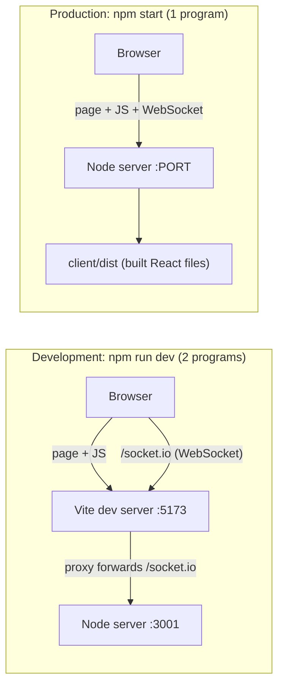

- **Dev:** Vite shows your React code with instant refresh. A **proxy** passes socket traffic to the Node server.
- **Production:** `npm run build` turns React into plain files in `client/dist`. Express serves those files and handles sockets on the **same port**.
- The browser code is the same either way: `io()` with no address means "connect to whoever served me". So there is no CORS setup and no URL to change between environments.

---

## 5. The big picture (architecture)

### 5.1 The golden rule

> **The server is the boss. Browsers only ask, and show what the server says.**

A browser never decides "I guessed right" or "I get 500 points". It sends "I guessed *dog*", and the server decides. This is what stops cheating, because the secret word never leaves the server except to the drawer.

### 5.2 System overview

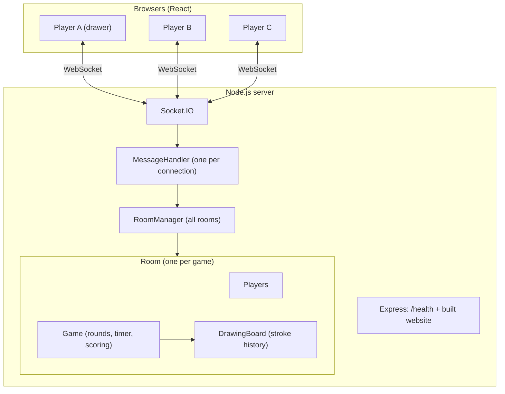

### 5.3 Who owns what

| Piece | Job | Real-life analogy |
|---|---|---|
| `RoomManager` | Keeps a list of all rooms by code | The hotel front desk |
| `Room` | Players, settings, host, phase | One hotel room with its guests |
| `Player` | One person: name, score, ready | A guest |
| `Game` | Turns, timer, word, scoring, hints | The game host/referee |
| `DrawingBoard` | Remembers every stroke | The whiteboard's memory |
| `MessageHandler` | Receives messages, checks rules | The receptionist |

### 5.4 Three kinds of state

| State | Where it lives | Lost when |
|---|---|---|
| **Connection** (`socket.id`) | Socket.IO | Tab closes or network drops |
| **Game/room state** | Server memory | Room empties or server restarts |
| **Screen state** | Browser (React) | Page refresh |

Screen state is only a **copy** of server state. If they ever disagree, the server wins.

### 5.5 Two meanings of "room"

| Our `Room` class | Socket.IO room |
|---|---|
| Game data and rules | A mailing list of sockets |
| `RoomManager.rooms` | Inside Socket.IO |

We use the same 6-digit code for both. `io.to(code).emit(...)` means "send to everyone in this game".

### 5.6 The three ways browser and server talk

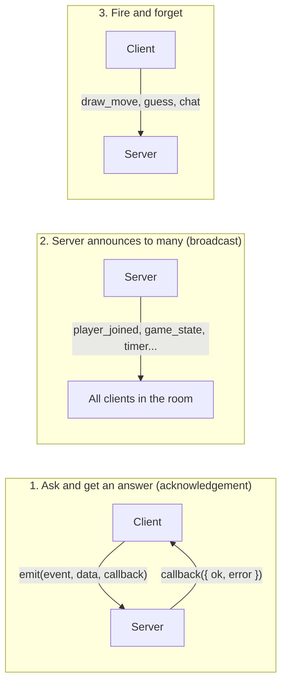

| Pattern | Used for | Why |
|---|---|---|
| Acknowledgement | create/join room, ready, start, play again | The caller must know if it worked, to show an error |
| Broadcast | player list, game state, timer, results | Everyone must hear about changes |
| Fire and forget | drawing, guessing, chatting | Happens very often; the result comes back as a broadcast |

---

## 6. How a game plays out (game flow)

### 6.1 Room phases

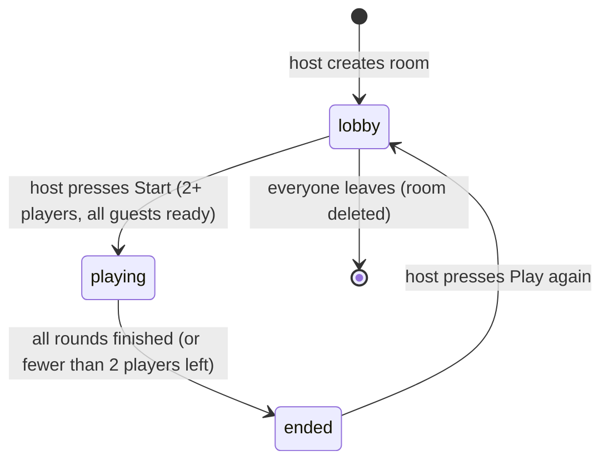

### 6.2 The turn cycle (inside `playing`)

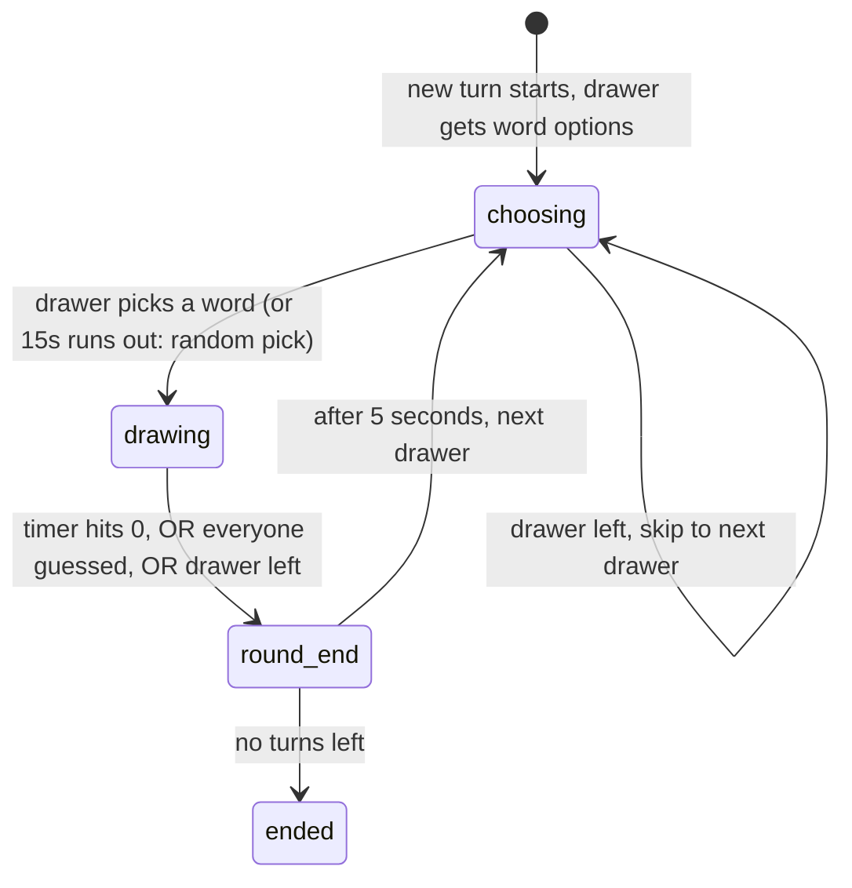

**Vocabulary:**
- A **turn** is one player drawing.
- A **round** is every player drawing once.
- Total turns = rounds x players. With 3 players and 3 rounds, there are 9 turns.

### 6.3 What the server does at each step

| Step | Server action | Who is told |
|---|---|---|
| Turn starts | Picks the next drawer, clears the canvas, picks word choices | Drawer gets the choices; everyone gets the state |
| Word picked | Starts the draw timer, creates blanks like `_ _ _ _` | Drawer sees the word; others see the blanks |
| Every second | Counts down, reveals hint letters at set times | Everyone gets `timer` |
| Correct guess | Scores the guesser, checks if everyone has guessed | Everyone gets "X guessed the word!" |
| Turn ends | Gives the drawer points, reveals the word | Everyone gets `round_end` |
| Last turn ends | Builds the leaderboard | Everyone gets `game_over` |

---

## 7. Every feature, explained

### 7.1 Room settings (set by the host, checked by the server)

| Setting | Allowed values | Default | Meaning |
|---|---|---|---|
| Max players | 2-20 | 8 | Room capacity |
| Rounds | 2-10 | 3 | Times everyone gets to draw |
| Draw time | 15-240 sec | 80 | Time to draw and guess each turn |
| Word choices | 1-5 | 3 | How many words the drawer can pick from |
| Hints | 0-5 | 2 | How many letters get revealed over time |
| Word mode | normal / hidden / combination | normal | See below |
| Private | true / false | true | Private rooms are never listed. Public rooms appear in "Browse public" while in the lobby and not full |

If someone sends values outside these ranges (for example by editing the page in DevTools), the server **clamps** them into range. For example, `rounds: 99` becomes `10`.

### 7.1b Public rooms and invite links

There are three ways to get into a room:

| Way | How |
|---|---|
| **Code** | Type the 6-digit code on the "Join with code" tab |
| **Invite link** | Open `/?room=CODE`. The code is pre-filled; you only add your name |
| **Browse public** | The "Browse public" tab lists open public rooms. Press Join on one |

A room shows up in the list only if **all three** are true: it is public (Private is unticked), it is still in the lobby, and it is not full. The list shows the host's name, `players/max`, rounds and draw time, and nothing else (no player names). It holds at most **10 rooms**, fullest first, and refreshes every 5 seconds (or press Refresh).

The list is only for **finding** rooms. Joining uses the same `join_room` event as before, and the server re-checks everything. So if a room fills up while you were looking at the list, you just get "Room is full".

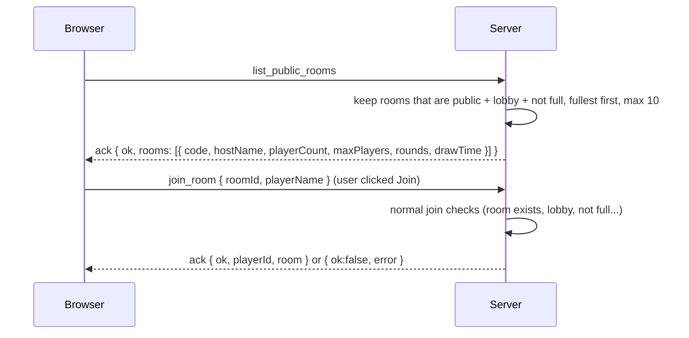

### 7.2 Word modes

| Mode | What guessers see | What the drawer picks from |
|---|---|---|
| **Normal** | Blanks, e.g. `_ _ _ _ _` with the word length | Single words |
| **Hidden** | Nothing, not even the word length | Single words |
| **Combination** | Blanks for both words | Two words glued together, like "cat umbrella" |

The word list has 5 categories (animals, objects, food, actions, places) with 25 words each. A word is not repeated within a game until the list runs out.

### 7.3 Lobby

- The room code is shown at the top. Share it with friends, or press **Copy invite link**. The link looks like `https://your-site/?room=482913`; opening it jumps straight to the Join tab with the code filled in.
- 👑 marks the host. ⏳ means not ready. ✅ means ready.
- **Guests** press **Ready**. The **host** presses **Start**.
- Start only works when there are **at least 2 players** and **all guests are ready**.
- If the host leaves, the **longest-present player becomes host**.
- If everyone leaves, the room is deleted.

### 7.4 Drawing

| Tool | How it works |
|---|---|
| **Brush** | Draws a smooth line. A single click leaves a dot |
| **Colors** | 10 choices |
| **Size** | Thin (4), Medium (10), Thick (22) |
| **Eraser** | Paints with the background color (white). Because it's a normal stroke, **undo works on it too** |
| **Undo** | Removes the last stroke |
| **Clear** | Wipes the whole canvas |

Only the **current drawer** sees the toolbar and can draw, and only during the drawing phase (not while picking a word).

**How a stroke travels** (this is the heart of the project):

1. The drawer presses the mouse. The browser records the position as **x and y between 0 and 1** (a fraction of the canvas, **not pixels**). This way a phone and a big monitor agree on where things are.
2. The drawer's own screen draws immediately (no waiting on the network).
3. Movement points are collected for 30 milliseconds, then sent together in one message. This **batching** avoids sending hundreds of tiny messages per second.
4. The server checks the data, stores it in the `DrawingBoard`, and relays it to everyone **except** the drawer.
5. Other browsers draw the new line segment with the same code the drawer used.

**Undo** works by replaying: pixels can't be un-drawn, so the canvas is wiped and every remaining stroke is drawn again.

### 7.5 Guessing and chat

There is one text box. What it does depends on who you are:

| Who | What you type | What happens |
|---|---|---|
| Guesser (hasn't guessed yet), during drawing | A guess | Server checks it. Wrong guesses show in chat for everyone |
| Drawer, or someone who already guessed | Chat | Only the drawer and correct guessers see it (green), so nobody can leak the word |
| Anyone, in the lobby / between turns | Chat | Everyone sees it |

The client picks a label (`guess` or `chat`), but the **server decides** what a message really is.

### 7.6 Word matching rules

| Rule | Example |
|---|---|
| Ignores UPPER/lower case | `DOG` matches `dog` |
| Ignores extra spaces | `  ice   cream ` matches `ice cream` |
| Ignores accents | `café` matches `cafe` |
| Ignores hyphens and punctuation | `ice-cream` matches `ice cream` |
| Ignores spaces when comparing | `icecream` matches `ice cream` |
| **Partial guesses do NOT count** | `do` or `its a dog` does not match `dog` |
| **"Close" = exactly one typo** (words of 4+ letters) | `lemoq` for `lemon`: the guesser privately sees "So close!", no points |

Partial matches are rejected on purpose. Otherwise a player could type `a`, `b`, `c`... or "the word is dog" to win.

### 7.7 Hints

If the host sets N hints, a random hidden letter is revealed at these times:

```
draw time x 1/(N+1), x 2/(N+1), ... x N/(N+1)
```

Example: 80 seconds and 2 hints, so letters appear at 26s and 53s. At most **half** of the letters are ever revealed. In Hidden mode there are no hints.

### 7.8 Scoring

| Who | Points |
|---|---|
| **Guesser** | `50 + 300 x (time left / total draw time) + order bonus`. Between 50 and 500 |
| **Order bonus** | 1st correct guesser +150, 2nd +100, 3rd +50, everyone after +0 |
| **Drawer** | **Half** of the average of what all guessers earned (guessers who failed count as 0) |

So speed wins: a fast, first guess is worth up to 500, a slow last guess about 50-100. The drawer is rewarded for drawing something that many people guess quickly, and earns nothing if nobody guesses.

**Why the drawer only gets half the average:** if the drawer got the *full* average, then in a game where every player draws once, everyone's total would come out almost the same (with 2 players it is mathematically always a tie). Paying the drawer less than a typical guesser makes the player who guesses best finish on top.

### 7.9 When does a turn end?

- The timer reaches 0, or
- Every guesser has guessed correctly, or
- The drawer disconnects.

Then everyone sees the word, the scores, and who draws next, for 5 seconds.

### 7.10 Game over

After the last turn the server sends the leaderboard and the winner (or a tie message). The **host** can press **Play again** to return to the lobby with scores reset and the same players.

### 7.11 When players leave mid-game

| Who left | What happens |
|---|---|
| The drawer, while drawing | Turn ends immediately, word is revealed, the drawer gets no points |
| The drawer, while choosing | Skip straight to the next drawer |
| A guesser | Removed. If everyone left has already guessed, the turn ends |
| So few players that fewer than 2 remain | The game ends and the leaderboard is shown |
| The host | The longest-present player becomes host |

---

## 8. Every route and event (the full API)

### 8.1 HTTP routes (Express)

| Method | Path | What it returns |
|---|---|---|
| `GET` | `/health` | `{ "status": "ok", "uptime": ... }`. Used by hosting platforms to check the app is alive |
| `GET` | `/assets/*`, `/index.html`, etc. | Files from `client/dist` (the built React app) |
| `GET` | anything else | `index.html` (so links like `/anything` still load the app) |

### 8.2 Socket events: Client sends to Server

**Room and lobby**

| Event | Payload | Reply (ack) | Who can send | Checks |
|---|---|---|---|---|
| `create_room` | `{ hostName, settings }` | `{ ok, playerId, room }` or `{ ok:false, error }` | Anyone not already in a room | Name required (max 20 chars); settings clamped |
| `join_room` | `{ roomId, playerName }` | `{ ok, playerId, room }` or error | Anyone not already in a room | Name; code is 6 digits; room exists; still in lobby; not full |
| `list_public_rooms` | none | `{ ok, rooms: [{ code, hostName, playerCount, maxPlayers, rounds, drawTime }] }` | Anyone | Only public, lobby-phase, non-full rooms; max 10, fullest first |
| `toggle_ready` | none | `{ ok }` | A player in a lobby | Must be in a room in lobby phase |
| `start_game` | none | `{ ok }` or error | **Host only** | Lobby phase; 2+ players; all guests ready |
| `play_again` | none | `{ ok }` or error | **Host only** | Game must be over |

**Gameplay**

| Event | Payload | Who can send | Checks |
|---|---|---|---|
| `word_chosen` | `{ word }` | **Current drawer** | Must be in the choosing phase; word must be one of the offered options |
| `guess` | `{ text }` | Anyone in a room | Text is trimmed and cut to 100 characters |
| `chat` | `{ text }` | Anyone in a room | Same as above. `guess` and `chat` use the same server router |

**Drawing** (all are fire-and-forget; only the **current drawer during the drawing phase** is accepted, others are silently ignored)

| Event | Payload | Meaning |
|---|---|---|
| `draw_start` | `{ x, y, color, size }` | Begin a stroke. `x`,`y` in 0-1; color like `#ff0000`; size 1-50 |
| `draw_move` | `{ points: [{x, y}, ...] }` | Add points to the stroke (max 100 per message) |
| `draw_end` | none | Finish the stroke |
| `canvas_clear` | none | Wipe the canvas |
| `draw_undo` | none | Remove the last stroke |

### 8.3 Socket events: Server sends to Client

| Event | Payload | Sent to | Meaning |
|---|---|---|---|
| `player_joined` | `{ player, players }` | Everyone except the joiner | Someone joined |
| `player_left` | `{ playerId, players, hostId }` | Everyone left in the room | Someone left (host may have changed) |
| `players_update` | `{ players, hostId }` | Everyone | Ready status or scores changed |
| `room_reset` | `{ room }` | Everyone | Host chose Play again; back to lobby |
| `round_start` | `{ drawerId, round, totalRounds, drawTime, wordOptions }` | Everyone; `wordOptions` is `null` except for the drawer | A new turn begins |
| `game_state` | `{ phase, round, totalRounds, drawerId, timeLeft, word, hint, guessed }` | **Each player separately** | The current truth. `word` is only filled in for the drawer, or for everyone after the turn ends |
| `timer` | `{ timeLeft }` | Everyone | Sent every second |
| `guess_result` | `{ correct, playerId, playerName, points }` (or `{ correct:false, close:true }`) | Everyone for a correct guess; **only the guesser** for "close" | Guess outcome |
| `chat_message` | `{ playerId, playerName, text, private? }` | Everyone (wrong guesses and chat), or only the drawer and correct guessers when `private` | A chat line |
| `round_end` | `{ word, scores, nextDrawer }` | Everyone | Turn over: shows the word and points gained |
| `game_over` | `{ winner, isTie, leaderboard }` | Everyone | Game finished |
| `draw_data` | `{ type:'start', x, y, color, size }` / `{ type:'move', points }` / `{ type:'end' }` | Everyone except the drawer | A stroke to draw |
| `canvas_clear` | none | Everyone (except the drawer when the drawer cleared it) | Wipe the canvas. Also sent to all at the start of every turn |
| `draw_undo` | none | Everyone except the drawer | Remove the last stroke |

### 8.4 Data shapes

```js
// player (what other browsers may see)
{ id, name, score, isReady, isHost }

// room (sent when you create/join)
{ code, phase, hostId, drawerId, settings, players: [player, ...] }

// stroke (stored on the server)
{ color: '#rrggbb', size: 10, points: [{ x: 0.12, y: 0.4 }, ...] }   // x, y between 0 and 1
```

---

## 9. Request flow diagrams

### 9.1 Create a room

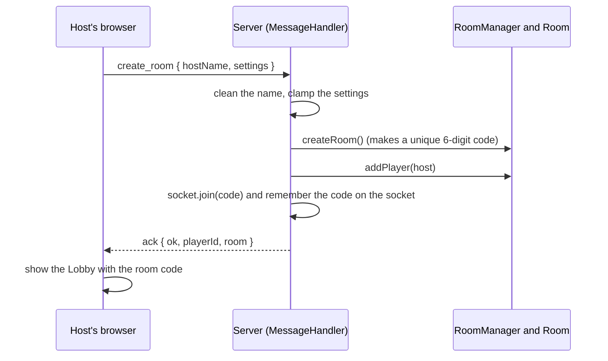

### 9.2 Join a room

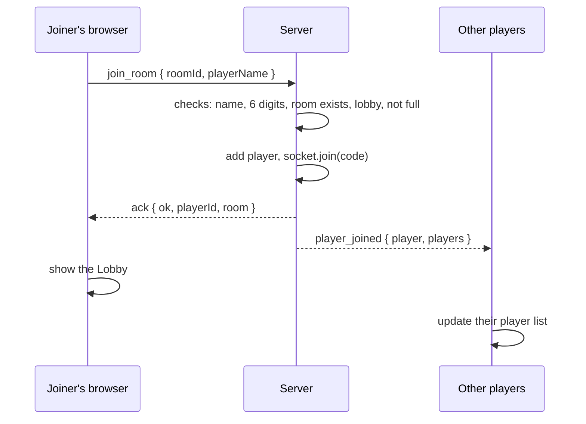

Errors (wrong code, full room, game started) come back as `ack { ok:false, error }` and the browser shows the message in red.

### 9.3 Ready up and start

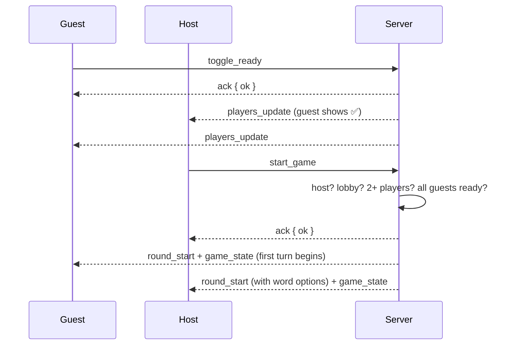

### 9.4 Drawing (the real-time part)

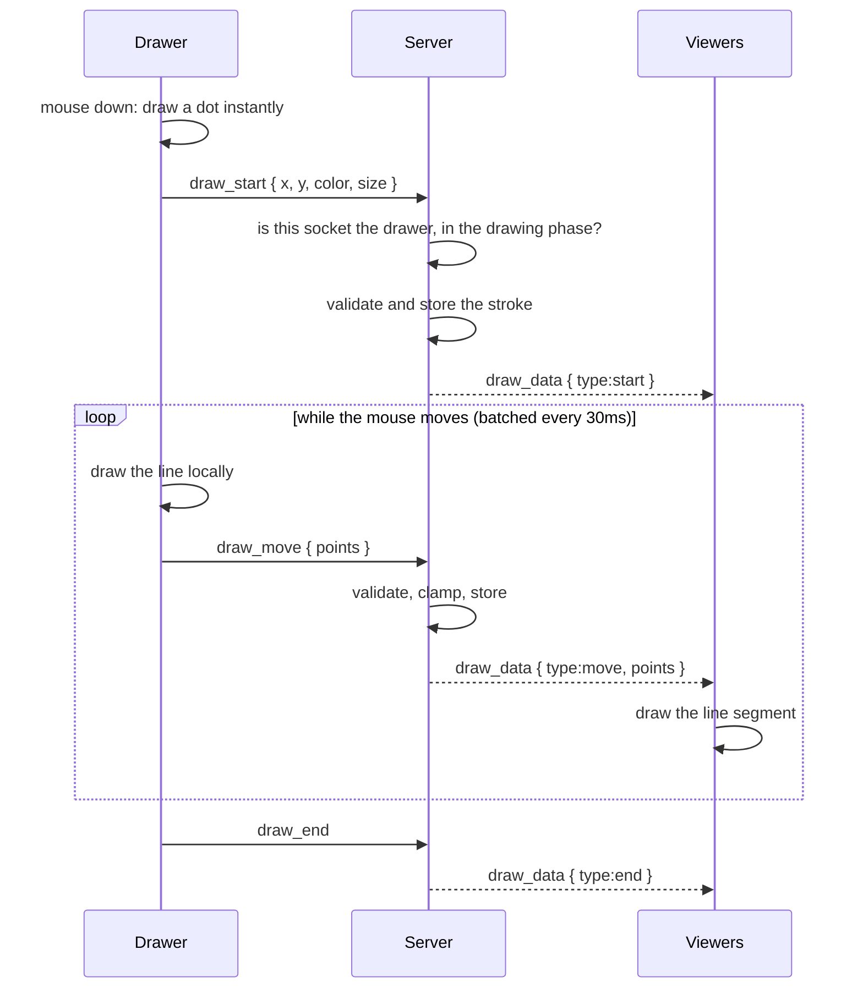

The drawer never gets their own stroke echoed back, because they have already drawn it locally.

### 9.5 Undo

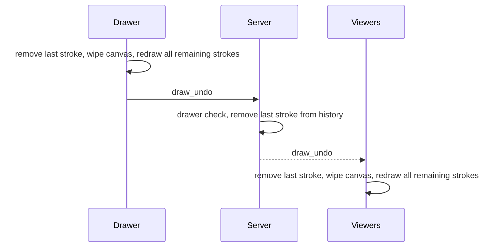

### 9.6 Picking a word

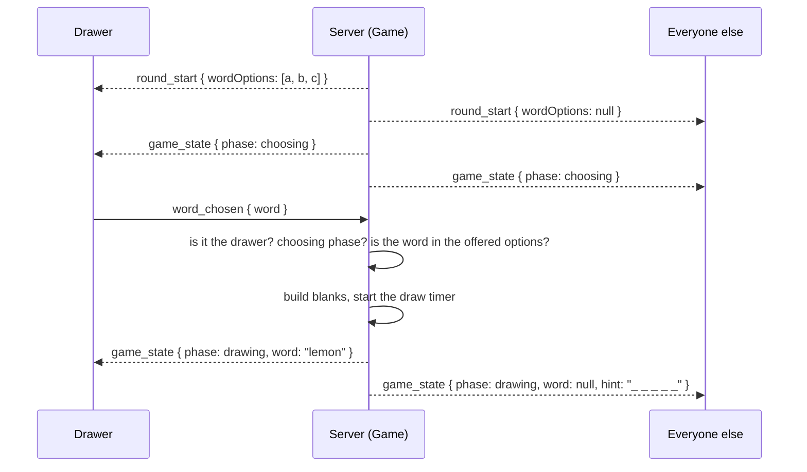

If the drawer does nothing for 15 seconds, the server picks a random option.

### 9.7 A correct guess that ends the turn

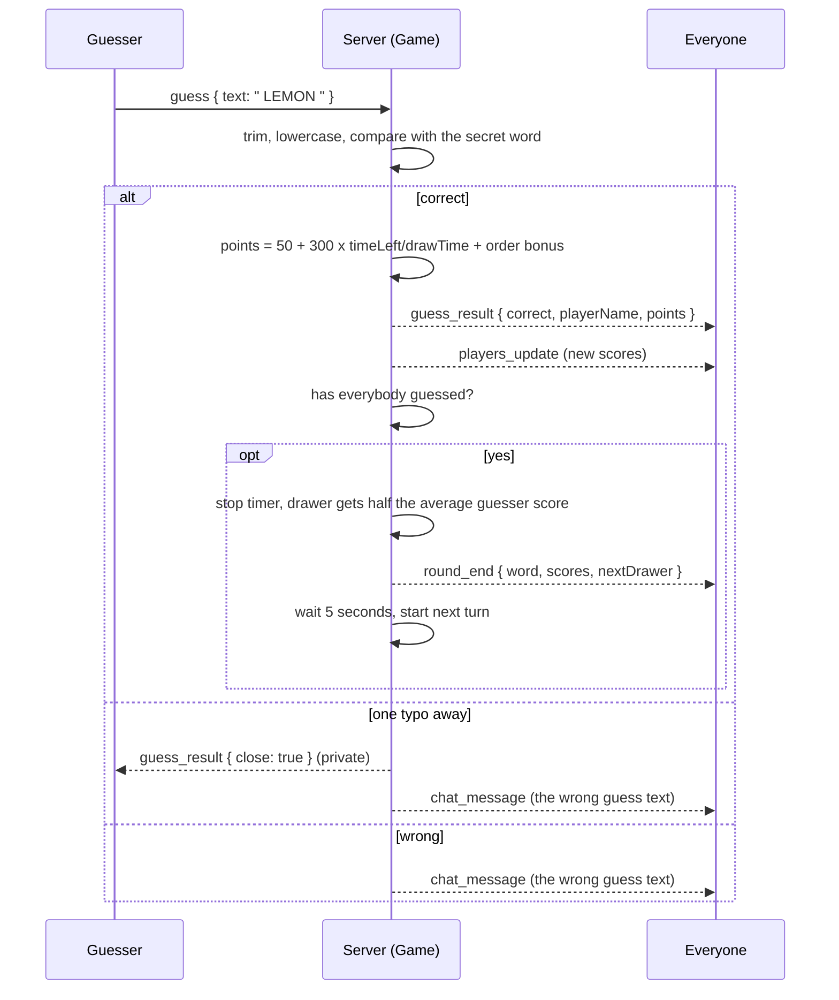

### 9.8 Someone disconnects

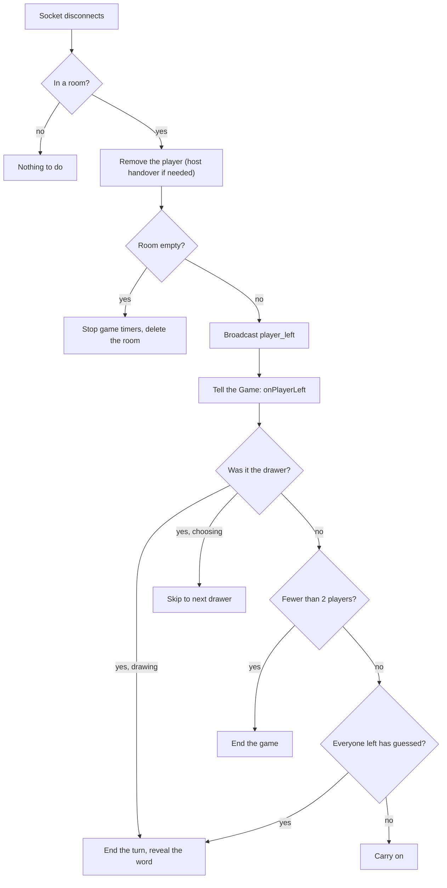

### 9.9 Game over and play again

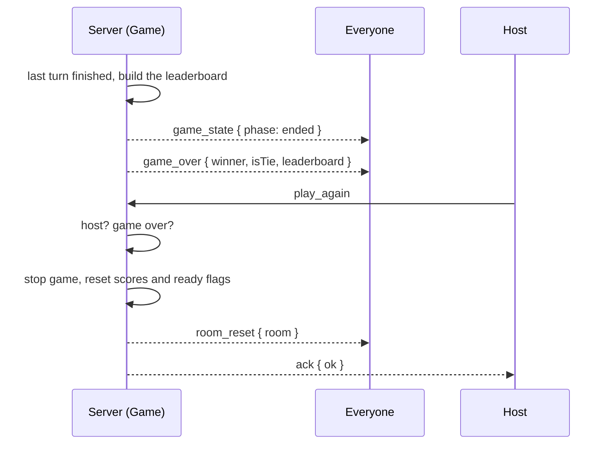

---

## 10. Security and fairness

| Concern | How it is handled |
|---|---|
| **Cheating by reading the word** | The secret word is only sent to the drawer (`game_state` is built **separately for each player**). Everyone else gets blanks |
| **Fake identity** | The server uses its own `socket.id`. The browser never sends a `playerId`, so nobody can pretend to be someone else |
| **Fake buttons** | Hiding the Start button is only cosmetic. The server re-checks "are you the host?" on every request |
| **Drawing out of turn** | Every drawing event is checked: right room, drawing phase, and you are the drawer. Otherwise it's ignored |
| **Choosing a made-up word** | The word must be one of the offered options |
| **Bad or huge input** | Names are trimmed and limited to 20 characters; messages to 100; coordinates are clamped to 0-1; colors must be `#rrggbb`; brush size limited to 1-50 |
| **Memory abuse** | Max 500 strokes per canvas, 5000 points per stroke, 100 points per message |
| **Crashing the server** | Every handler is wrapped in `try/catch`, so a bad message can't take the server down |
| **Memory leaks** | Empty rooms are deleted and their timers stopped |
| **Predictable room codes** | Codes come from Node's secure random generator (`crypto.randomInt`), not `Math.random` |
| **Leaking the word through chat** | The drawer's and correct guessers' chat is private; the word itself is never shown in a "guessed" notice |

Checks run in this order for every request: **valid data, in a room, right phase, right role**.

---

## 11. Folder structure: what each file does

```
skribbl_clone/
├── package.json            Root scripts: dev, build, start, install:all
├── render.yaml             Render deployment settings (build/start/health check/Node version)
├── README.md               This file
├── .gitignore              Keeps node_modules, dist, .env out of git
│
├── server/                 The game brain (Node.js)
│   ├── package.json
│   └── src/
│       ├── index.js            Starts Express + Socket.IO; serves client/dist; /health
│       ├── MessageHandler.js   One per connection: receives events, checks rules, replies
│       ├── RoomManager.js      All rooms by code; makes unique 6-digit codes
│       ├── Room.js             Players, settings, host, phase; broadcast helpers; public listing
│       ├── Player.js           One player (name, score, ready); safe public view
│       ├── Game.js             Turns, timer, word, hints, scoring, chat routing
│       ├── DrawingBoard.js     Stores and validates strokes; undo; clear
│       ├── settings.js         Setting limits, defaults, clamping, name cleaning
│       ├── words.js            Categorized word list; picks word choices
│       └── wordMatch.js        Guess checking: case, trim, accents, "close"
│
└── client/                 What the player sees (React + Vite)
    ├── package.json
    ├── vite.config.js          Dev proxy: forwards /socket.io to the server
    ├── index.html              The single page React fills
    └── src/
        ├── main.jsx            Starts React
        ├── App.jsx             Chooses the screen: Home, Lobby, or Game
        ├── socket.js           The one shared socket connection
        ├── useGameSocket.js    ALL socket listeners and the state they produce
        ├── drawing.js          CanvasBoard class: draws strokes, undo, redraw
        ├── index.css           Styles
        └── components/
            ├── Home.jsx          Name, create room (settings), join room
            ├── SettingsForm.jsx  The settings inputs
            ├── BrowseRooms.jsx   Public room list (polls every 5s), Join buttons
            ├── Lobby.jsx         Room code, invite link, players, Ready/Start
            ├── Game.jsx          Game screen: header, canvas, overlays
            ├── Canvas.jsx        The canvas, toolbar, sending strokes
            ├── Chat.jsx          Chat and guess box
            ├── Scoreboard.jsx    Live player scores
            └── GameOver.jsx      Winner, leaderboard, Play again
```

### How the client is organized

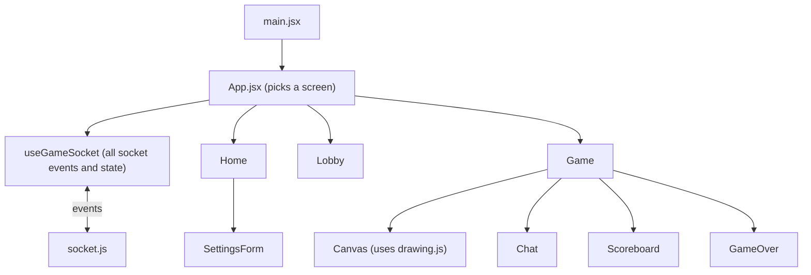

- **`App.jsx`** only decides which screen to show: no room means Home, lobby phase means Lobby, playing/ended means Game.
- **`useGameSocket.js`** is the only place that listens to socket events. Components just receive data as props.
- The client never edits the player list itself; it **replaces** it with whatever the server sends.

---

## 12. Deployment

The app is deployed as **one Web Service on Render**. Express serves the built React app *and* the Socket.IO server from the same port, so there is only one thing to deploy and no CORS to configure.

**Why not Vercel or Netlify alone?** Their backends are *serverless functions*: they start for one request and then stop, so they cannot keep a WebSocket open. The game needs a server that stays running. (They could host only the React frontend, with the backend elsewhere, but that adds a second deployment, CORS rules and a server URL setting for no benefit here.) Render and Railway both run a normal, always-on Node process, so WebSockets work.

| Setting | Value |
|---|---|
| Service type | Web Service (Node) |
| Build command | `npm run build` |
| Start command | `npm start` |
| Port | Provided automatically through `PORT` |
| Health check | `/health` |
| Node version | 20 (`NODE_VERSION` env var) |
| Instances | **1** (game state lives in memory) |

These settings are also written down in `render.yaml` in the project root, so the service can be recreated from the repo.

**What happens on deploy:**

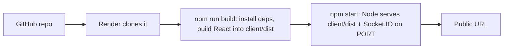

**Steps**
1. Push the repository to GitHub.
2. On Render: **New, Web Service**, connect the repo (or use the `render.yaml` Blueprint).
3. Confirm the build and start commands above.
4. After the build, open the URL, then `/health`, then test creating and joining a room from two devices.
5. Put the URL at the top of this README.

(Railway works the same way: it reads the same `build` and `start` scripts. Just click **Generate Domain** under Networking.)

**Platform notes and constraints**
- `client/dist` is not committed. It is built on the server during deploy.
- **The build installs dev dependencies on purpose.** Hosting platforms set `NODE_ENV=production`, which makes `npm install` skip dev dependencies, but Vite (the build tool) is one. The root `build` script therefore runs `npm --prefix client install --include=dev`. Without it the deploy fails with "vite: not found".
- **Free tier sleeps** after about 15 minutes with no traffic. The next visit wakes it up, which takes up to a minute. Pinging `/health` every few minutes with a free uptime monitor keeps it awake.
- All game state is in memory, so **run exactly one instance**, and a restart or redeploy ends every running game.
- WebSockets and HTTPS: the browser connects with `io()` and no address, so it automatically uses `wss://` on the https site. Nothing to configure.

---

## 13. Known limitations

| Limitation | Why | Planned fix |
|---|---|---|
| Refreshing the page drops you from the room | Your identity is the socket, which changes on reconnect | Session token saved in the browser |
| 6-digit codes can be guessed by brute force | Only 1,000,000 possibilities | Rate-limit join attempts |
| Public list refreshes by polling (5s) | Simpler than live push | Socket.IO "browser" room with broadcasts |
| No kick/ban | Not built yet | Host-only kick |
| No chat rate limit | Not built yet | Limit messages per second |
| No way to leave a room except closing the tab | No `leave_room` event | Add the event |
| Late joiners can't join a running game | Joining is only allowed in the lobby | Spectator mode |
| Only one server instance | Rooms live in memory | Redis if scaling |
| Free hosting sleeps when idle (first load up to ~1 min) | Render free tier | Free uptime monitor pinging `/health` every ~5 min (planned), or a paid plan |
| Restart or redeploy ends all running games | State is in memory only | Persist state (Redis) if needed |
| Scores are tuned by feel | Constants in `Game.js` | Adjust after more playtesting |

---

## 14. Glossary

| Word | Meaning |
|---|---|
| **WebSocket** | A connection that stays open so server and browser can message each other any time |
| **Socket.IO** | A library built on WebSockets that adds named events, rooms and replies |
| **Event** | A named message, like `join_room` |
| **Payload** | The data that travels with an event |
| **Acknowledgement (ack)** | A reply callback: "did it work?" |
| **Broadcast** | Sending one message to many clients at once |
| **Socket** | One browser tab's connection to the server |
| **`socket.id`** | The unique ID the server gives each connection. We use it as the player's ID |
| **Room** | Our game session (and, separately, a Socket.IO group used to send messages to its players) |
| **Host** | The player who created the room (or inherited it); can start the game |
| **Drawer** | The player drawing this turn |
| **Turn / Round** | One player drawing / everyone drawing once |
| **Stroke** | One continuous line drawn from mouse-down to mouse-up |
| **Normalized coordinates** | Positions as fractions (0 to 1) of the canvas, not pixels |
| **Batching** | Grouping many small updates into one message |
| **Server-authoritative** | The server makes every decision; clients only display |
| **Proxy** | A middleman that forwards requests to another server (used by Vite in dev) |
| **Build** | Turning source code into optimised files a browser can run |
| **`client/dist`** | The folder where the built React app is placed |
| **Clamp** | Forcing a number into an allowed range |
| **Levenshtein distance** | The number of single-letter edits (add, remove, change) to turn one word into another; used for "close" guesses |
